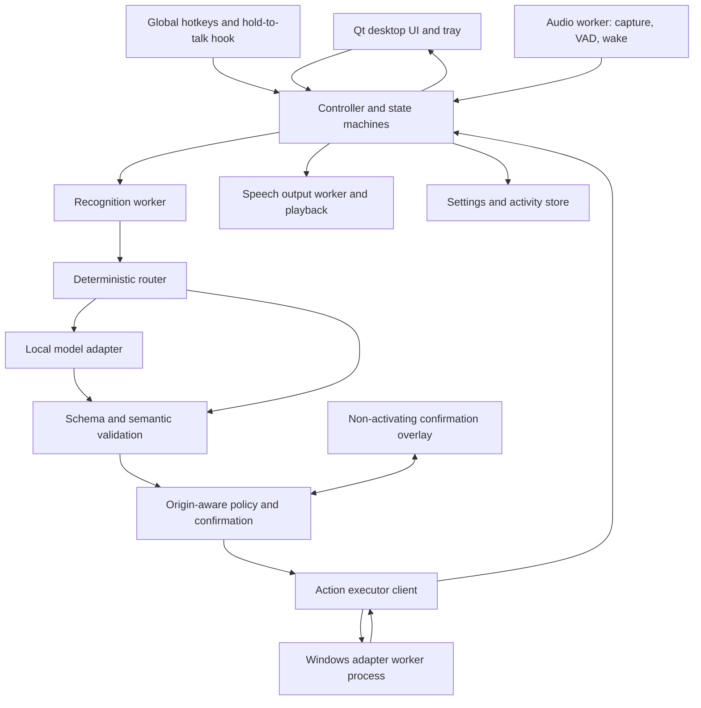

# Autumn — Technical Requirements Document

Version: 2.0 (revised after adversarial review)
Date: 31 October 2026
Status: Proposed architecture. Implementation and benchmarks pending. Nothing here has been installed or measured.

Related documents: [PRD](PRD.md) · [Implementation plan](IMPLEMENTATION_PLAN.md) · [Adversarial review](ADVERSARIAL_REVIEW.md). The PRD defines product scope; this document defines interfaces and engineering constraints. A conflict between documents is resolved by recording a decision in section 2 before implementation.

## 1. Architecture summary

| Area | Choice | Reason and qualification |
|---|---|---|
| Platform | Windows 11 x64 | Verify the installed build. Windows 10 is not a target. |
| Language | Python, version chosen in Phase 0 | Newest version for which every native dependency has a Windows wheel; minimum 3.11. |
| Desktop | PySide6 with Qt Quick/QML | Native window, animated status, tray. Qt for Python is LGPL: dynamic linking and notices required if distributed. |
| Language-model runtime | Separately installed Ollama on loopback | Reuses local model hosting. Behind an adapter so a different local runtime can replace it. |
| Language model | Baseline `qwen3:1.7b`; bake-off in Phase 0 | See section 2 (D-02). Digest pinned. |
| Speech recognition | whisper.cpp; `base.en` vs `small.en` decided by measurement | Integration option chosen in Phase 0 (D-03). |
| Speech output | Piper, one English voice; Windows built-in voice as fallback | Piper's engine and each voice have licenses to check before redistribution. |
| Wake detection | openWakeWord via ONNX Runtime | Optional. Pretrained "hey jarvis" model evaluated first. |
| Audio I/O | sounddevice/PortAudio candidate | Validate enumeration, capture and playback; WASAPI shared mode by default. |
| Validation | Pydantic plus JSON Schema | Reject invalid plans before dispatch. |
| Windows automation | pywin32/ctypes, pycaw-class audio API, a maintained WinRT binding for media sessions, pywinauto UI Automation | Prefer APIs and control identifiers over screen coordinates. |
| Persistence | SQLite plus versioned JSON settings | Local, serverless. |
| Packaging | Locked environment with launcher for the personal MVP; standalone folder (`pyside6-deploy` first) for complete version 1 | Smoke-built at every phase gate; fallback packagers in section 14. |

No dependency version is claimed as verified. Resolve and hash-lock exact versions after the Phase 0 compatibility spike.

## 2. Decision log and open decisions

### Resolved decisions

| ID | Decision | Rationale |
|---|---|---|
| D-01 | Stop cancels all work, closes any recording, discards queued plans and pending confirmations, and silences playback. It returns capture to `PTT_READY` if hold-to-talk is configured, and to `DISABLED` if wake mode was armed. | Safe, predictable, and consistent with PRD section 5. |
| D-04 | Hold-to-talk uses a low-level keyboard hook that matches only the configured chord, discards everything else, and stores nothing. A toggle mode uses the plain `RegisterHotKey` API. Stop and confirm/cancel hotkeys use `RegisterHotKey`. | A plain hotkey reports presses but not releases. A hook is not delivered input while an elevated window has focus; document this and keep the toggle and button. Verify whether `RegisterHotKey` events arrive under an elevated foreground window. |
| D-05 | Confirmation is a non-activating, always-on-top overlay plus global confirm and cancel hotkeys. It never takes keyboard focus. | Clicking a normal window changes the foreground, which would invalidate the dictation target check. |
| D-06 | Policy decisions depend on origin (section 8). Wake-origin requests can run only low-risk catalogued actions. | Audio from speakers or videos must not exceed wake privileges. |
| D-07 | Dictated text may not contain line breaks in version 1 (reject or convert to spaces, user's choice per request). Typing uses Unicode input events. Maximum 1,000 characters per preview. | A newline is Enter in most apps; Unicode input avoids keyboard-layout dependence. |
| D-08 | Windows adapters run in a supervised worker process with a heartbeat. A hung or crashed worker is killed and restarted with bounded backoff; the interrupted action is never replayed. | A hung UI Automation or COM call in a thread cannot be killed safely. |
| D-09 | File search uses the Windows Search index scoped to configured roots when available, otherwise a bounded scan with default exclusions. | A 50,000-entry traversal cap fails on realistic drives. |
| D-10 | App launch targets come from a user-reviewed catalog with three descriptor types: executable path, shortcut, packaged-app identity. The model selects an ID, never a path. | Packaged apps have no stable executable path. |
| D-11 | Planner schema is generated per request from the enabled skills and live registry values, using enums for app, folder, routine and candidate IDs. | Smaller grammar, no invented IDs, better small-model behavior. |
| D-12 | Spoken replies default to at most two sentences and about 15 seconds. | No hands-free barge-in exists in version 1. |
| D-13 | Packaging smoke build runs at every phase gate. Complete version 1 requires a standalone build; the personal MVP may use a launcher. | Late packaging failures are the classic schedule killer. |
| D-14 | Free conversation is P2; capabilities help is generated from the registry. | A 2B model's free answers are costly to evaluate and easy to over-trust. |

### Open decisions (resolved in Phase 0, each with a pass rule)

| ID | Question | Candidates | Pass rule |
|---|---|---|---|
| D-02 | Language model | `qwen3:1.7b` (baseline); `qwen3.5:2b`; optionally `gemma4:e2b` (QAT build). Third-party sources report the default `gemma4:e2b` tag near 7 GB and a QAT build near 4.3 GB; verify on the model library. | Highest held-out dev accuracy that meets NFR-04, NFR-07, NFR-09 and the "approximately 2B" size class. A candidate that is larger on disk or in total parameters than the class is a product decision for the owner, not an automatic upgrade. |
| D-03 | Recognition integration | (a) a Python binding running inside a supervised worker process; (b) the whisper.cpp server example as a child process bound to `127.0.0.1` on an ephemeral port; (c) faster-whisper. | Persistent loaded model, working cancellation, Windows wheels or binaries for the chosen Python, clean shutdown, no listener reachable beyond loopback. Prefer (a). |
| D-15 | Recognition model size | `base.en` vs `small.en` (others if needed) | Lowest error on the owner's recorded speech, app names and numbers within NFR-04. |
| D-16 | Python version | 3.11 and newer | All pinned wheels install and import on one version. |
| D-17 | Media control binding | A maintained WinRT projection for system media sessions vs media-key injection | Reads session state reliably; otherwise media actions are reported `unverified`. |
| D-18 | Search backend | Windows Search index vs bounded scan | Index available and covering the configured roots on the target laptop. |
| D-19 | GPU path | Ollama on the discrete GPU vs CPU | Measured latency and memory; discrete GPU is actually selected on hybrid graphics. |
| D-20 | Wake model | Pretrained "hey jarvis" | NFR-10 plus license acceptable for intended use. |

## 3. Threat model

In scope: accidental harm from model errors; audio from speakers, videos or other people issuing commands; hostile content in filenames or screen text; malformed or oversized model output; stale or replayed confirmations; supply-chain compromise of dependencies and model files; another local process calling the model runtime.

Out of scope: malware already running as the user (it can already do everything Autumn can); a determined attacker with local administrator rights; protecting data from other accounts on a shared machine beyond Windows permissions.

Principles: the model proposes, application code decides; origin limits authority; every consequential action is bound to exact arguments; external content is data; nothing leaves the machine except explicit setup downloads and the user's own website-open requests.

## 4. Component topology



Process model: the Qt main thread owns presentation only. A controller coordinates work through typed queues and Qt signals. Audio callbacks only perform bounded buffer writes (no model calls, no disk I/O). Recognition, speech output and Windows automation run in supervised worker processes. The language-model runtime is external and reached through a bounded loopback HTTP client.

Network surface: Autumn exposes no endpoint that can trigger an action. A recognition worker may use a loopback listener only if option D-03(b) is chosen, bound to `127.0.0.1` on an ephemeral port, started and owned by Autumn, and closed on Quit. No FastAPI or browser front end in version 1.

## 5. State and lifecycle

Capture state and task state are separate so "busy" is never confused with microphone access.

Capture states: `DISABLED`, `PTT_READY` (microphone closed, hotkey active), `ARMED_WAKE`, `RECORDING`, `SUSPENDED_PLAYBACK`, `DEVICE_ERROR`.

Task states: `IDLE`, `TRANSCRIBING`, `ROUTING`, `AWAITING_CLARIFICATION`, `AWAITING_CONFIRMATION`, `EXECUTING`, `SPEAKING`, `CANCELLING`, `ERROR`.

- First launch: capture `DISABLED`, task `IDLE`. Enabling voice moves to `PTT_READY`; wake mode is a separate opt-in.
- Hold-to-talk: recording while the chord is held; release ends the utterance. Maximum recording 20 seconds with a visible warning before truncation. Toggle mode ends on the second press or at the maximum.
- Wake mode: a local detector holds the device open; an accepted wake starts bounded command capture. Initial silence endpoint candidate 800 ms, tuned in testing. Commands accepted after wake carry `wake` origin.
- Clarification context lives 30 seconds. Choices appear in the UI; a voice follow-up uses the configured activation method.
- Speech output and the model never enable capture.
- Playback suspends recording and wake recognition; a short configurable acoustic tail precedes rearming. Voice interruption during playback is deferred; keyboard Stop stays available.
- Microphone off closes capture immediately, discards buffered audio, and cancels transcription and routing derived from it before dispatch. It does not undo a running action.
- Stop increments a session cancellation generation. It silences playback, discards input and queued plans, cancels pending confirmations, and applies D-01 to capture state.
- Sleep and lock disconnect capture and block dispatch. Resume and unlock leave capture disabled until the user re-enables it. Detect session changes with Windows session-notification and power messages through a native event filter; test both classic sleep and Modern Standby.
- Quit closes Autumn-owned workers and audio devices. It never stops a shared Ollama service. A single-instance mutex prevents a second capture stream.

An action already accepted by Windows may complete after cancellation. The UI distinguishes "queue stopped" from "effects reversed". Clipboard changes, typed characters, launched apps and media events cannot all be rolled back.

## 6. Command processing

1. Normalize the transcript conservatively: whitespace, punctuation, case, known app aliases. Preserve dictated text.
2. Deterministic router: match exact supported patterns against catalog aliases. A match requires that no unmatched words remain and no negation or conjunction words appear that the grammar does not cover ("don't open notepad", "open notepad and delete…" fall through to the model or a clarification). Fuzzy alias matching uses a documented threshold and clarifies below it.
3. If no exact match, send the request, a concise catalog of enabled skills, and bounded recent context to the local model.
4. Request a discriminated JSON result: action plan, clarification, answer (capabilities help only until FR-21 ships), or unsupported.
5. Parse and validate; reject unknown fields, unknown actions, invalid values and oversized output.
6. Resolve semantic references against registries: app IDs, folder aliases, candidate file IDs, routine IDs.
7. Enforce policy by origin independently of the model.
8. Dispatch one step at a time and verify through the adapter.
9. Render the outcome from execution results, then synthesize a short spoken response.

### Model runtime settings (starting values, to be tuned)

- Per-request JSON Schema from the live registry (D-11). Put `kind` first. Keep variants compact; if schema size slows decoding or lowers accuracy, split planning into two calls (choose skill, then fill arguments).
- Context 4,096 tokens, output about 256 tokens, low temperature, one request at a time.
- Disable thinking through the runtime's supported option, then verify per candidate that structured output still conforms. Do not assume the option worked.
- Set an explicit `keep_alive` while Autumn is active so latency is warm, and let it expire after Quit. Offer a memory-saving setting.
- Allow only the pinned local model digest. Reject any model entry that is a remote or cloud tag, using the runtime's model-details response, and refuse to start routing if the digest differs from the manifest.
- Routing timeout 15 seconds. On malformed output allow one bounded repair attempt, then clarify. Self-reported confidence never authorizes an action.

Free-form model output is never evaluated as Python, a shell command, a launch path or a privileged instruction. Conversation replies cannot trigger tools.

## 7. Core data contracts

### Planner result

A discriminated union with `additionalProperties: false` at every level. Arguments are also a discriminated union, never a free dictionary.

```json
{
  "kind": "action_plan",
  "steps": [
    {"skill": "app.open", "arguments": {"app_id": "notepad"}}
  ]
}
```

```json
{"kind":"clarification","message":"Which folder do you mean?","choices":["Documents","Downloads"]}
```

```json
{"kind":"answer","text":"I can open apps, find files, and control your volume."}
```

```json
{"kind":"unsupported","message":"I do not have an email-sending action yet."}
```

Request IDs, origin, target handles, risk categories, confirmation IDs and permission flags are application-generated and never accepted from model output. At most three model-planned steps per request; user-authored routines at most five; no nesting or loops.

### Action execution envelope

Validated internal fields: `request_id`, `step_id`, `skill`, typed `arguments`, `origin`, resolved target, target snapshot, `cancel_generation`, deadline, policy decision, optional confirmation reference. One running request plus five pending; overflow shows a visible busy response.

### Execution result

`request_id`, `step_id`, status, result code, user-readable message, verification method, elapsed time, optional artifact reference. Status is `succeeded`, `failed`, `unverified`, `cancelled` or `partial`. A URL handed to the browser with no page check is `unverified` for page load.

### Events

`CaptureStateChanged`, `TaskStateChanged`, `TranscriptReady`, `PlanReady`, `ConfirmationRequested`, `StepFinished`, `SpeechStarted`, `SpeechFinished`, `ComponentUnavailable`. Each carries a request ID where applicable and a cancellation generation. Late events from cancelled generations cannot trigger downstream effects.

## 8. Skills, policy and confirmation

### Skill declaration

Name, version, argument schema, preconditions, permission category, timeout, cancellation checkpoints, verification method, retry policy, side-effect description.

### Skills

| Skill | Arguments | Implementation and verification |
|---|---|---|
| `app.open` | Catalog `app_id` | Launch by descriptor type. Verify best-effort: process or window for executables; for packaged apps and single-instance apps that hand off to a running process, accept a new top-level window or report `unverified`. No model-supplied executable or arguments. |
| `folder.open` | Folder alias or selected search-result ID | Resolve an existing directory; ask the shell to open it; report handoff separately from window detection. |
| `website.open` | Registered site ID, or URL (policy below) | Parse; allow only `http` and `https`; reject `file:`, shell handlers and embedded commands. Page load unverified. |
| `audio.set_volume` | Integer 0–100 | Core Audio set; read back. |
| `audio.set_mute` | Boolean | Read back. |
| `media.control` | `play_pause`, `next`, `previous` | Use the media-session API and observe state where available (D-17); otherwise report delivery `unverified`. Never retry a toggle blindly. |
| `screen.capture` | Monitor selection | Process is DPI-aware for correct bounds on scaled and multi-monitor setups; confirm the file exists with nonzero dimensions; note that protected content can capture as black; no screenshot analysis. |
| `files.search` | Filename query, type hint, configured root IDs | Windows Search index when available, else bounded scan (below). Up to 20 results shown. No content reads. |
| `text.type` | Text (no line breaks), target ID | Preview and confirmation; see dictation rules below. |
| `routine.run` | Routine ID | Expand user-authored steps, apply each step's policy for the routine's origin, halt on first failure by default, show completed steps. |
| `help.capabilities` | none | Generated from the registry; no model call. |

### File search rules

Explicit configured roots only. Canonicalize paths and enforce root boundaries. Skip reparse points. Default exclusions include the Windows directory, application data, and common dependency folders. With the index backend: query only within configured scopes and report if a root is not indexed. With the scan fallback: default limits of 10 seconds and 200,000 visited entries (tunable), partial results returned and limits disclosed. Type words ("spreadsheet", "PDF", "photo") map to extension sets. A selected result is revalidated before opening.

### Dictation rules

- Target chosen from a window picker; stored as a handle, process, title and control identity snapshot.
- Confirmation shows exact text and destination. Confirm and cancel use the overlay and global hotkeys (D-05); no click is required in a normal window.
- After confirmation: check that the target is the foreground window and that its editable control is the focus. If not, activate it using only methods allowed by Windows, re-verify, and abort rather than type if verification fails.
- Type in short chunks via Unicode input events; re-verify foreground and focus between chunks; stop on mismatch and report `partial` with the count typed.
- Never press Enter, Tab or any shortcut. Reject text containing line breaks or control characters.
- Never type into password fields or elevated windows. Clipboard paste is off by default.
- Do not retry after uncertain delivery.

### Origin-aware policy matrix

Origins: `typed`, `button`, `ptt_voice`, `wake_voice`, `routine`. A routine inherits the origin of the request that started it, so a wake-started routine only runs steps allowed for `wake_voice`.

| Skill | typed / button | ptt_voice | wake_voice |
|---|---|---|---|
| `app.open`, `folder.open` | Allow | Allow | Allow |
| `website.open` registered site | Allow | Allow | Allow |
| `website.open` other URL | Allow | Confirm | Deny |
| `audio.*`, `media.control` | Allow | Allow | Allow |
| `screen.capture`, `files.search` | Allow | Allow | Allow |
| `text.type` | Confirm | Confirm | Deny |
| `routine.run` | per step | per step | per step (wake rules) |
| `help.capabilities` | Allow | Allow | Allow |

Policy is application code and is tested without a model. Confirmation never overrides unsupported capabilities or Windows restrictions.

### Confirmation protocol

Record: random ID, request and step IDs, origin, hash of canonical arguments, hash of target snapshot, creation time, 30-second expiry, consumed flag. Confirmation is by overlay button or hotkey; spoken "yes" is not accepted in version 1. Any change to arguments or target invalidates it. Records are single use.

Read content is never converted to instructions. Routines and registries change only through explicit UI operations. New app and folder registrations require user selection. Refuse execution in a locked session or against an elevated window the process cannot control.

## 9. Audio and speech

- Capture mono, normalize to 16 kHz PCM, resample devices with other native rates.
- Bounded in-memory ring buffer; overflow aborts the utterance with a visible message.
- Local voice-activity detection for endpointing; choose and pin an implementation in Phase 0.
- Detect all-zero or near-zero capture and report the likely causes: the Windows microphone privacy setting for desktop apps, a muted device, or the wrong device.
- Recognition: explicit English mode; a short vocabulary hint; discard results from silence using no-speech and confidence signals plus a minimum voiced-duration rule, because the recognizer can produce plausible text from noise. Do not trust a short phrase from prolonged silence as a command.
- Prefer in-memory or pipe transport to the recognition worker. If a worker needs WAV files, use per-request temporary files, deleted on success, failure and next start.
- Enumerate input and output devices, persist stable identifiers where available, and fall back to explicit selection if a device disappears. Test a Bluetooth headset: opening its microphone may switch it to a lower-quality profile.
- Persistent speech-output worker; cache only generic acknowledgements. If Piper fails or is missing, fall back to the Windows built-in voice, then to text only.
- Spoken replies follow D-12. Result text in the UI is always complete.
- Recognition failure leaves typed commands available; speech output failure leaves text and results available.

## 10. Storage and privacy

```text
%LOCALAPPDATA%\Autumn\
  config\settings.json
  data\jarvis.db
  models\stt\
  models\tts\
  logs\
  tmp\
```

The model runtime owns its own cache; inventory it without duplicating weights. User-selected screenshot folders may be elsewhere.

SQLite tables: `schema_version`, `action_events`, `routines`, `routine_steps`, `app_catalog`, and optional `conversation_turns`. Settings hold schema version, devices, hotkeys, enabled skills, registered targets, search roots, retention and model digest. Atomic settings replacement; transactional migrations with backups.

Default history: timestamps, skill IDs, origin, status and error codes, duration, non-sensitive summaries. Do not persist raw audio, dictated text, full prompts, screenshots or complete sensitive paths in logs. Conversation persistence is off by default. Debug audio capture requires explicit opt-in and a visible retention period. Logs rotate; retention defaults to seven days; "Clear history" purges application-managed records and temporary artifacts. Exported files and screenshots are separate user files. No claim of secure erasure. Encrypted storage is not in version 1. Diagnostics export previews its contents and excludes transcripts and audio by default.

The hold-to-talk hook processes key events in memory only and discards non-matching events; it never logs keystrokes.

## 11. Runtime, network and resources

- Use `127.0.0.1` for runtime access. No LAN listener, no inbound firewall rule for Autumn.
- Loopback is not authenticated: another local process can reach the model runtime. Never place action authority in that runtime.
- Setup downloads are explicit. Normal operation makes no cloud calls, analytics, automatic model updates or remote error reports. Reject remote or cloud model entries (section 6).
- Recognition is CPU-first, optionally accelerated if Phase 0 proves it. The language model uses the GPU only after compatible acceleration is detected, and the discrete GPU is confirmed in use on hybrid-graphics laptops. An 8 GB VRAM figure identifies neither vendor nor compatibility.
- One model request, one recognition job and one action sequence at a time. Bound all queues.
- Warm the model after explicit activation. On Quit, release owned workers; do not disturb a shared runtime.
- Resource gates follow PRD NFR-07 and NFR-09 and require measurement including worker processes and incremental runtime use, on mains and on battery.
- Timeouts: routing 15 seconds; action-specific 5–15 seconds; external page load and app startup shown separately. No unbounded waits.
- Retry only known safe, idempotent operations; never repeat text entry or media toggles after uncertain delivery.

## 12. Reliability and errors

| Condition | Required behavior |
|---|---|
| Runtime absent or model missing | Explain the setup gap; keep UI and deterministic typed commands. |
| Runtime timeout or malformed plan | Cancel; one bounded repair for malformed plans; no action on failure. |
| Model digest or tag not allowed | Refuse routing; explain; deterministic commands still work. |
| Microphone unplugged | Close the stream, show device error, require explicit re-selection. |
| Silent capture | Report probable Windows privacy block or mute; point to the setting. |
| Speaker unavailable | Continue with text; no repeated playback attempts. |
| Access denied or elevated target | Report the inaccessible target; no privilege escalation. |
| Target changes during typing | Stop; mark `partial` with count typed. |
| Windows adapter hang or crash | Mark the active step failed or partial; restart with bounded backoff; never replay. |
| Stop during queued work | Discard pending steps and stale events; show completed steps. |
| Corrupt settings | Preserve a copy; restore defaults with microphone disabled; explain recovery. |
| Second instance launched | Focus the existing window; do not open capture. |
| Disk full | Fail the write with a clear message; keep running. |

Status messages derive from adapter results. The model never announces success before execution. After three restart attempts in a session a component is disabled and recovery controls are shown.

## 13. Verification strategy

Unit tests: schemas, semantic resolution, deterministic router (including negation and trailing-word rejection), policy matrix, confirmation binding and expiry, cancellation generations, state transitions, root-boundary validation, retention, newline rejection.

Property tests: for every skill and origin, no execution path exists without a policy decision, and a model-supplied field cannot change origin, permission or target kind.

Contract tests: fake adapters and recorded model responses.

Audio tests: a replaceable audio source so recorded fixtures can drive the full pipeline without a microphone; fixtures include the owner's speech, silence, noise, near-field and far-field, and synthesized speech played back to confirm half-duplex behavior. Recognition errors are scored separately from routing errors.

Windows integration tests: disposable test windows and folders, never personal files. A small purpose-built target application provides an editable control, a password-style control, and a window that can steal focus on command, for dictation tests. Cover packaged-app and single-instance launch, elevated-window refusal, display scaling, multiple monitors, sleep and Modern Standby, lock and unlock, default audio device change, and Bluetooth devices.

Accessibility: operate every flow by keyboard alone; verify controls and states with Narrator; set explicit accessible names and roles on QML elements.

Evaluation: separate development and held-out sets under a lock-box rule (Implementation Plan section 13). Record accuracy, argument accuracy, unsupported handling, failure categories, and p50/p95 for the defined timestamps. Measure on the owner's English speech, accent and realistic background noise.

Release gates follow PRD sections 9 and 10. Wake mode has its own gate. Hold-to-talk stays available if wake fails.

## 14. Packaging, supply chain and licenses

1. Smoke-build the app at each phase gate. Verify QML assets, native DLLs, audio runtime, ONNX runtime and model paths in the build.
2. Personal MVP: locked environment plus launcher shortcut. Complete version 1: per-user standalone folder and installer, no administrator rights for normal install. If `pyside6-deploy` fails on a native dependency, evaluate another packager; record the choice in section 2.
3. Models and voices download separately from the executable, with free-space display, checksum or digest verification, and a manifest of tested artifacts. Recover from interrupted or corrupt downloads.
4. Hash-pin Python dependencies and use a lockfile; install from the lockfile only. Review additions to the lockfile.
5. License inventory before any redistribution: Qt for Python (LGPL notices), Piper engine (GPL) and each voice's own license, whisper.cpp and its model weights, openWakeWord code and its pretrained models (verify whether the pretrained models carry non-commercial terms), each language model's license. Personal use and public distribution carry different obligations; a GPL component run as a separate process still needs review before redistribution.
6. Test launch from paths with spaces and non-ASCII characters on a clean Windows account.
7. Document Ollama as a separate prerequisite and whether it keeps running after Quit.
8. Uninstall options distinguish app binaries from settings, downloaded models, screenshots and the shared Ollama cache.
9. Updates are manual at first and preserve settings. Code signing is a distribution decision. Test an unsigned build against Windows Defender early, since keyboard hooks, input injection and unsigned packaged binaries are all heuristically suspicious.

## 15. Sources and verification status

Upstream references (checked at the time of the v1.0 draft; re-verify when pinning versions):

- [Ollama Windows](https://docs.ollama.com/windows)
- [Qwen3 1.7B on Ollama](https://ollama.com/library/qwen3:1.7b)
- [Ollama structured outputs](https://docs.ollama.com/capabilities/structured-outputs)
- [whisper.cpp](https://github.com/ggml-org/whisper.cpp)
- [Piper](https://github.com/OHF-Voice/piper1-gpl)
- [openWakeWord](https://github.com/dscripka/openWakeWord)
- [pywinauto](https://github.com/pywinauto/pywinauto)
- [Qt deployment (pyside6-deploy)](https://doc.qt.io/qtforpython-6/deployment/deployment-pyside6-deploy.html)

| Claim | Status on 31 October 2026 |
|---|---|
| openWakeWord provides a pretrained "hey jarvis" model | Confirmed from the project's published model list. Pretrained-model license not verified. |
| Ollama offers cloud-hosted tags | Reported by third-party sources; verify in current Ollama docs. |
| `qwen3.5:2b`, `gemma4:e2b` exist as Ollama tags with the reported sizes | Third-party reports only; verify on the model library. |
| All Windows wheels, `think` option behavior, Windows Search index access, GPU acceleration | Unverified until Phase 0. |

## 16. Changes from version 1.0

Added the decision log and open decisions, threat model, origin-aware policy, non-activating confirmation, hold-to-talk mechanism and its limits, `PTT_READY` state, newline and focus rules, supervised Windows worker, app catalog, Windows Search index backend, dynamic planner schema, model allowlist, silent-capture detection, test infrastructure, supply-chain and license controls, and staged packaging. See [ADVERSARIAL_REVIEW.md](ADVERSARIAL_REVIEW.md).

## 17. Personal launch implementation — D0021

Schema 8 stores `start_brain_on_launch`, `broad_open_access` and `hands_free_on_launch`. Normal launch warms the pinned brain first, then discovers Start Menu, packaged and App Paths apps, then enables the saved hands-free preference. Activation alone gets a 40-second warm-up budget (plus up to five seconds for installed-server startup); ordinary planning retains its 15-second deadline. A three-minute refresh preserves the five-minute model lease when memory saver is off. Shared Ollama remains separate from owned audio workers.

Broad opening enables validated newly discovered entries, refreshes metadata at the same installed target while retaining aliases, preserves explicit disables, and compiles complete user-entered local paths into ephemeral IDs. Supported document associations reuse `app.open`; paths never enter planner arguments and ephemeral entries are not persisted. Ordinary Windows permissions, shell/shortcut validation and generation checkpoints still apply.

Hands-free reuses bounded capture/VAD and local STT, discards unaddressed speech, and routes “Autumn, …” with restricted `wake_voice` origin. Playback/acoustic tail pauses capture; Stop, microphone-off, device failure, lock/sleep and Quit prevent rearming. Minimize hides to the visible tray without changing the current microphone setting. `--login` suppresses launch listening; explicit isolated `--data-dir` trials suppress all automatic services. Source-level startup tests use fake audio with a real local model/catalog; no physical-audio acceptance is inferred. The native launcher and icon use a no-argument Windows shortcut and dynamically linked Qt resources.

## 18. Response latency — D0022 / schema 9

Recognition keeps small.en and its confidence/silence gates; CPU threads are capped at eight available logical processors after an interleaved owner-machine comparison. Voice-enabled personal startup primes recognition and Piper in their owned workers without opening audio devices. Capture feeds successive 30 ms frames to one WebRTC detector per recording, retains bounded pre/post-roll and trims surrounding silence before decoding. `speech_pause_ms` defaults to 450 with bounded 400–1500 ms validation; the UI offers 450/800/1200 ms choices. Capture remains bounded to 20 seconds and playback retains its acoustic tail.

Spoken success/handoff acknowledgments are brief while full execution/verification detail stays onscreen; failures and partial dictation remain detailed. When Windows supplies no launch PID, the adapter immediately returns the same unverified handoff outcome instead of polling two seconds for an impossible PID match. Known-PID window checks are preserved. No change to planning deadlines, origin authority, model digests, held-out data or acceptance thresholds is implied.
